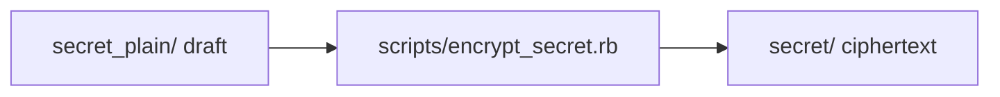

This page replaces the al-folio sample files (`_projects/1_project.md` through
`9_project.md`, the sample `_news/` announcements and the `profiles` sample page).
Each section shows a feature working, then gives the snippet to copy.

**How to view it:** run `bin/serve --unpublished`, then open
`http://127.0.0.1:4000/reference/`. `published: false` keeps it out of production builds.
Remove that line only if you deliberately want it on the live site.

For posts, secret posts, games, image localization and blog hover previews, see
`README.md`. That guide is the source of truth for those workflows.

## Images

`_includes/figure.liquid` renders responsive, zoomable images. Wrap them in
Bootstrap grid rows: `col-sm` columns share a row equally, and `col-sm-8` +
`col-sm-4` gives a 2/3 + 1/3 split. `img-fluid rounded z-depth-1` makes an image
responsive, with rounded corners and a shadow.

<div class="row">
    <div class="col-sm mt-3 mt-md-0">
        
    </div>
    <div class="col-sm mt-3 mt-md-0">
        
    </div>
    <div class="col-sm mt-3 mt-md-0">
        
    </div>
</div>
<div class="caption">
    Three equal columns. Captions go in a <code>div.caption</code> right after the row.
</div>

<div class="row justify-content-sm-center">
    <div class="col-sm-8 mt-3 mt-md-0">
        
    </div>
    <div class="col-sm-4 mt-3 mt-md-0">
        
    </div>
</div>
<div class="caption">
    A 2/3 + 1/3 split.
</div>



```html
<div class="row justify-content-sm-center">
  <div class="col-sm-8 mt-3 mt-md-0">
    
  </div>
  <div class="col-sm-4 mt-3 mt-md-0">
    
  </div>
</div>
<div class="caption">Caption text.</div>
```



In ordinary posts, plain Markdown `` is
usually enough (see the image pipeline in `README.md`).

## Footnote tooltips

Standard Markdown footnotes turn into click-to-open bubbles, with no list at the
bottom of the page[^demo-note]. The site uses GFM input, so the inline `^[note]`
shortcut does **not** work.

[^demo-note]: The bubble can hold Markdown: _italics_, **bold** and [links](/blog/).

```markdown
This line has some extra context[^about-origin].

[^about-origin]: The bubble can render Markdown—links, _italics_, **bold**, etc.
```

## Collapsible panels

These are the animated panels used on `/work/` and the home page. They need
`collapsible_panels: true` in the page's front matter, which loads
`assets/js/collapsible-panels.js`. Styling lives in `_sass/_layout.scss` under
`.collapsible-panel`.

<details class="collapsible-panel work-case">
<summary><strong>Example panel</strong></summary>
  
Markdown works in here: **bold**, lists, links.

- one
- two
  
  <div class="collapsible-panel__content">
    {{ demo_panel | strip | markdownify }}
  </div>
</details>



```liquid
<details class="collapsible-panel work-case">
<summary><strong>Panel title</strong></summary>
  
Markdown body here.
  
  <div class="collapsible-panel__content">
    {{ panel_body | strip | markdownify }}
  </div>
</details>
```



There is also a lighter, unstyled `` tag from
`_plugins/details.rb`:


The body is **Markdown**.




```liquid

The body is **Markdown**.

```



## Video, audio and embedded HTML







```liquid



```



You can also embed a standalone HTML file with an iframe. Here is the bundled Plotly demo:

<iframe src="{{ '/assets/plotly/demo.html' | relative_url }}" frameborder="0" scrolling="no" height="500px" width="100%" style="border: 1px dashed grey;"></iframe>

```html
<iframe src="/assets/plotly/demo.html" frameborder="0" scrolling="no" height="500px" width="100%"></iframe>
```

## Math

MathJax is on site-wide (`enable_math: true`). Inline math uses `$$ E = mc^2 $$`
inside a sentence: $$ E = mc^2 $$. A display equation goes on its own line:

$$
\sum_{k=1}^\infty |\langle x, e_k \rangle|^2 \leq \|x\|^2
$$

## Diagrams (Mermaid)

Front matter: `mermaid: { enabled: true, zoomable: false }`.



Source of the diagram above:

    ```mermaid
    flowchart LR
      a --> b --> c
    ```

## Charts (Chart.js)

Front matter: `chart: { chartjs: true }`. The fenced block is a Chart.js config in JSON.
`echarts: true` and `vega_lite: true` work the same way, with ```` ```echarts ```` and
```` ```vega_lite ```` blocks.

```chartjs
{
  "type": "bar",
  "data": {
    "labels": ["a", "b", "c", "d", "e"],
    "datasets": [{ "label": "example series", "data": [3, 7, 4, 9, 5] }]
  }
}
```

## Tabs

Front matter: `tabs: true` (uses the `jekyll-tabs` plugin).




Content of the first tab.



Content of the second tab.






```liquid


First tab.


Second tab.


```



## Sortable tables

Front matter: `pretty_table: true`. Data can come from a JSON file (`assets/json/table_data.json`):

<table
  data-toggle="table"
  data-url="{{ '/assets/json/table_data.json' | relative_url }}"
  data-height="260"
  data-search="true">
  <thead>
    <tr>
      <th data-field="id" data-sortable="true">ID</th>
      <th data-field="name">Item name</th>
      <th data-field="price" data-sortable="true">Price</th>
    </tr>
  </thead>
</table>

```html
<table data-toggle="table" data-url="/assets/json/table_data.json" data-search="true">
  <thead>
    <tr><th data-field="id" data-sortable="true">ID</th><th data-field="name">Item name</th></tr>
  </thead>
</table>
```

## Other page switches (not demoed here)

These are wired into the layouts and load their scripts only when a page turns them on.

| Front matter | Effect |
| --- | --- |
| `toc: { sidebar: left }` | Sidebar table of contents (used on this page) |
| `code_diff: true` | Renders ```` ```diff2html ```` blocks as side-by-side diffs |
| `typograms: true` | ASCII diagrams in ```` ```typograms ```` blocks |
| `pseudocode: true` | Algorithm blocks in ```` ```pseudocode ```` (turns off MathJax on that page) |
| `tikzjax: true` | TikZ drawings in `<script type="text/tikz">` |
| `map: true` | Leaflet maps from ```` ```geojson ```` blocks |
| `giscus_comments: true` / `cusdis_comments: true` | Comments under a post. Giscus needs the `giscus:` block in `_config.yml` filled in; it is currently empty. |
| `related_posts: false` | Hides "more posts" on a post |
| `_styles:` (multi-line string) | Page-scoped CSS (see `_pages/resume.md`) |
| `full_width: true` | Drops the content max-width (see `_pages/rcg.md`) |

The upstream [al-folio example posts](https://github.com/alshedivat/al-folio/tree/main/_posts)
show each of these in full.

## Projects collection (`_projects/`)

The `/art/` page (`_pages/projects.md`) renders a card grid from `_projects/*.md`.
That page is currently unpublished because the folder holds no real projects. To use
it, add a project file and remove `published: false` from `_pages/projects.md`.

```yaml
---
layout: page
title: my project
description: one line shown on the card
img: assets/img/12.jpg # card image; leave empty for a text-only card
importance: 1 # lower numbers sort first
category: music # must match one of display_categories on the grid page
redirect: https://example.com # optional: the card links here instead of the project page
giscus_comments: true # optional, needs giscus configured
---
Project page body: images, text and everything else on this page.
```

The grid page options are `display_categories: [music, acting, youtube]` (one
heading per category; needs `enable_project_categories: true`) and
`horizontal: true` (wide cards via `_includes/projects_horizontal.liquid`).
`enable_masonry` in `_config.yml` packs the cards.

## News / announcements (`_news/`)

Announcements render on `/news/` (`_pages/news.md`, currently unpublished) and on any
page with `news: true` in its front matter (the home and work layouts support it). The
list is controlled by `announcements:` in `_config.yml`.

```yaml
---
layout: post
date: 2025-10-22 15:59:00-0400
inline: true # true: the body shows inline in the list; false: the title links to a full page
related_posts: false
title: Only needed when inline is false
---
A short announcement with Markdown and emoji :sparkles:
```

## Multi-profile page (`profiles` layout)

`_layouts/profiles.liquid` lays out several people, each with an image and a
Markdown bio file from `_pages/`:

```yaml
---
layout: profiles
permalink: /people/
title: people
profiles:
  - align: right
    image: prof_pic.png
    content: person_one.md # a Markdown file in _pages/ (exclude it in _config.yml)
    image_circular: false
    more_info: >
      <p>Optional HTML under the photo</p>
---
```

Keep the permalink unique. The old sample claimed `/work/` and had to be excluded.
