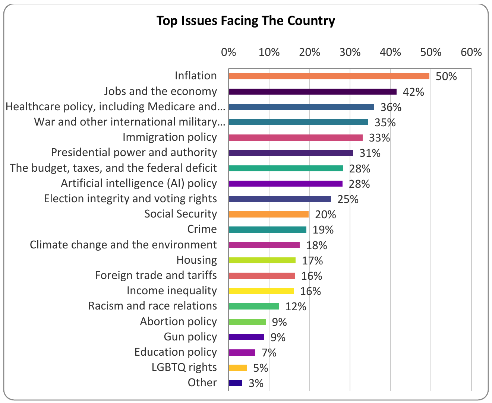
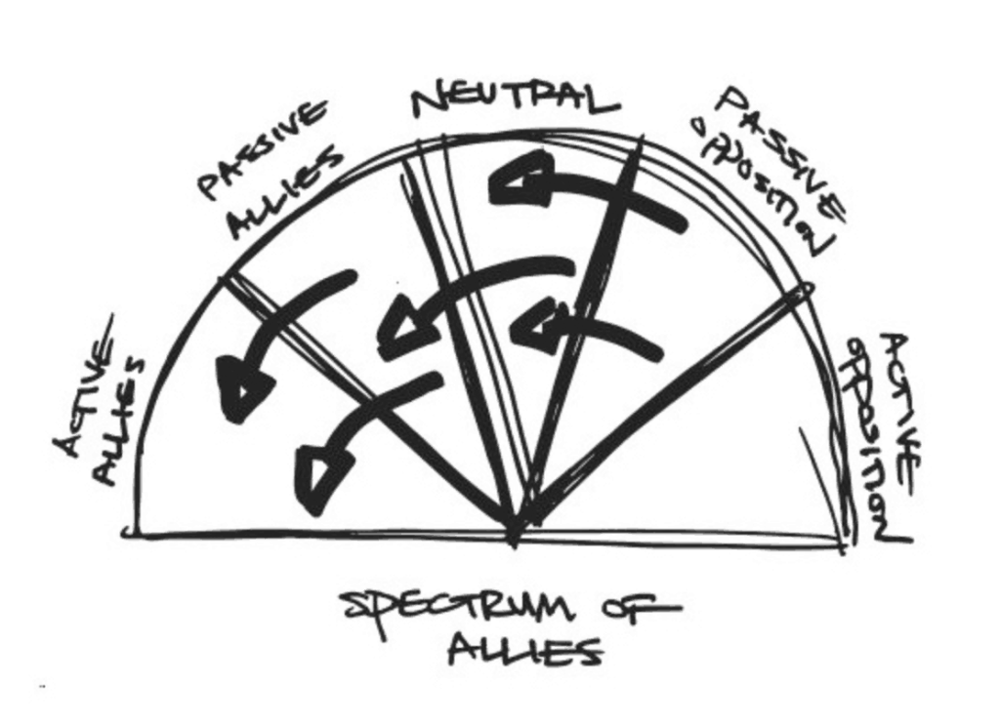

Many movements in 21st-century American history fall into the trap of polarization. Even after achieving great heights within one end of the political spectrum, their bills are doomed in the Senate or vetoed by a less enthusiastic President.

Will the Pro-Human Movement suffer the same fate? How do we as activists prevent AI safety (and other democracy reforms) from becoming similarly polarized?

The answer comes in four parts:

**1. Bread and butter issues govern American politics**

We often see politics as being divisive, but there are actually numerous issues in American life that [cross partisan lines](https://www.american.edu/centers/latin-american-latino-studies/upload/poll-what-do-voters-think-about-the-gov_10-30-2026-3.pdf):
- Inflation / cost of living
- Jobs / the economy
- Healthcare policy

*Top issues for 5,000 registered voters, September 2026. Note AI policy tied with the budget and deficit, at 28%. Source: [YouGov for American University's Center for Latin American and Latino Studies](https://www.american.edu/centers/latin-american-latino-studies/upload/poll-what-do-voters-think-about-the-gov_10-30-2026-3.pdf).*

People vote about day-to-day issues. While our politicians seem to be busy discussing things like trans rights or gun control, what *really* matters in politics is *bread and butter issues*.

This hypothesis (called "[economic voting](https://en.wikipedia.org/wiki/Economic_voting)") would contend that most issues that tend to animate people -- such as immigration, or the trade war with China -- come back to the economy. Trump rode the wave of anger and fear that comes from factory jobs moving overseas. The Republicans' fixation on immigration has worked because immigrants are a scapegoat for the rising cost of living and the lack of jobs for everyday people.

If this is correct, then when politicians and activists *do* focus on bread and butter issues, we can do extraordinary things.

**2. AI relates deeply to bread and butter issues**

Big Tech & AI is deeply unpopular. Why is that?

AI and data centers are emblematic of the pain that ordinary Americans face every day. Data centers [increase the cost of electricity](https://cepr.org/voxeu/columns/how-data-centres-affect-electricity-prices-and-whom). AI is displacing workers of all walks of life. These impacts will only grow larger.

Big Tech is unpopular in a way that Big Oil is not. Data centers are ugly, loud, and expensive. They are a drain on communities. They are the physical manifestation of the greed of Tech Oligarchs, who are corrupting our politicians, taking away our jobs, and may even be threatening the existence of humanity.

All of these are prime bread and butter issues (political corruption, though not listed above, has also been shown to be a top-of-mind American issue).

Candidates like [James Talarico](https://www.stlpr.org/npr/2026-11-03/democrat-james-talarico-wins-texas-senate-seat) and [Abdul El-Sayed](https://www.ktvu.com/news/abdul-el-sayed-mike-rogers-us-senate-michigan-2026-midterm) campaigned fiercely against Big Tech, and they won. Of course, people recognize the *potential* benefits of AI. But they see this technology being deployed without their consent, without a democratic process. This goes for data centers, Flock cameras, and yes, even existential risk.

**3. A Worthy Narrative**

A narrative is like the brand or packaging on the "product", which is the demand that you're fighting for.

An excellent narrative is essential for reaching large numbers of people. While some people might join a protest for the particular policy, far more people will join because of the *narrative* and community. Consider that at the March on Washington, Dr. King said, "[I have a dream](https://en.wikipedia.org/wiki/I_Have_a_Dream)...." not "I have a policy proposal."

Narrative can make the difference between a niche movement and one that goes mainstream. Consider the gay rights movement. For centuries, queer people have faced persecution and mistreatment. Then, [Evan Wolfson](https://en.wikipedia.org/wiki/Evan_Wolfson) came up with a new narrative: Marriage Equality. Easy to understand, and a message that resonated with the notions of tradition that are common in American life: why shouldn't gay people be able to marry the people they love? Gay marriage was opposed by Bill Clinton, who signed the [Defense of Marriage Act](https://en.wikipedia.org/wiki/Defense_of_Marriage_Act) in 1996, and by Barack Obama in 2004, but by 2015 it [became the law of the land](https://en.wikipedia.org/wiki/Obergefell_v._Hodges). That is the power of social change.

Central to this theory is having a radically inclusive movement. One can shout from the rooftops about existential risks -- but if a movement only has certain demographics, it will never scale to the numbers we need. That means that we need liberals, conservatives, young people, retirees, parents, factory workers, software engineers -- all of these people. That means that activists have to be welcoming of *ideological discomfort.* It means that there may be fascists or racists or anti-data center or MAGA people at your protests or community events and that those people should be welcomed with open arms. Diversity gives our movement the numerical strength that we need to win.

**4. Punch Up**

Sociologist [Charles Tilly](https://en.wikipedia.org/wiki/Charles_Tilly) says that successful movements display WUNC: they are Worthy, Unified, Numerous, and Committed. Something about those attributes is moving and inspiring. The canonical example is [the photo](https://en.wikipedia.org/wiki/Birmingham_campaign) from the 1963 Birmingham campaign of Walter Gadsden, a Black teenager, being bitten by a police dog. The image itself is a narrative -- it draws the viewer in, and highlights the injustice of the issue. It challenges you to decide: which side am I on?

*The [spectrum of allies](https://commonslibrary.org/spectrum-of-allies/). The goal is to move each group one wedge closer. Image: The Commons Social Change Library.*

The goal of action like a sit-in or march is two-fold:

a) Rally passive supporters. In the Pro-Human Movement, there are so many passive supporters. In fact, [77% of Americans](https://techstrong.ai/articles/most-americans-want-powerful-ai-development-slowed-or-stopped-quinnipiac-poll-finds/) want the development of powerful AI slowed down or stopped until it can be proven safe. The reason it hasn't happened yet is because these passive supporters don't know how to take action! The goal of activists is to bring them in and give them the support so they can demand that our representatives act.

b) Isolate the opposition. The top 1% will never win in a fair fight, because we outnumber them 99:1. By dramatizing the issue (through tactics like protests, rallies, and non-violent direct action) we give the 99% a seat at the table. We demand that politicians take a stand -- and we know (for the reasons stated above) that regulating AI is a winning issue.

**Conclusions**

Our movement is young, and there is much work to be done to fight the threat from advanced technology. And yet, I am hopeful that excellent narrative can capture the latent support. In some ways, the anti-AI sentiment is the greatest political opportunity we have seen since the rise of Trump. It is on us as a movement to channel this energy in the right direction.

---

**Footnote**

What is a simple, clear framing that can mobilize people against the real risks of advanced artificial intelligence? Perhaps it's not one name, but a suite of names that appeal to different demographics with a common narrative. Here are some names I've thought of:
- No Tech Kings. People vs Billionaires. Drain the Swamp.
	- These tap into sentiments on concentration of power, which I feel resonates deeply with people across the spectrum. However, the associations here are rather partisan.
- Pro-Human Revolution. Humans First. Human Power. Human Liberation.
	- These are good. The word "human" is a little meta.
	- For a movement, I think it's good, but for a rally, it's a little non-specific.
- Freeze AI. Pause AI. Regulate AI.
	- Very clear, but somehow distant from people's everyday concerns. Also, "AI" seems to have negative connotations.

Regardless, it's the culture and story that is told through one-on-one conversations. People come to a protest because it's fun, and because their friends are there. We're using No Tech Kings for a rally on December 14th in San Francisco. Given the liberal audience, I think this is a strong framing. But I'm supportive of other people organizing other events and seeing what sticks!
